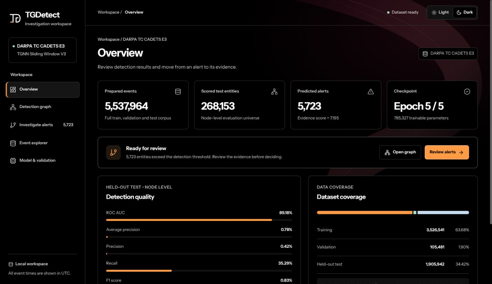
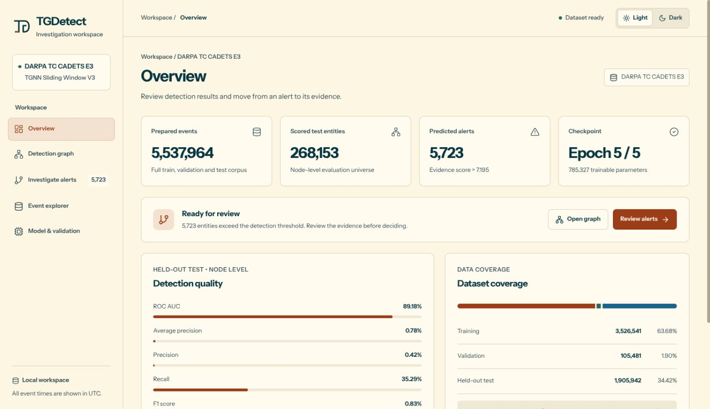

<p align="center">
  <picture>
    <source media="(prefers-color-scheme: dark)" srcset="docs/assets/logo-dark.svg">
    
  </picture>
</p>

<h1 align="center">TGDetect V3</h1>
<p align="center">Temporal graph detection. Clear evidence. Connected investigation.</p>

<p align="center">
  <a href="https://github.com/Pratham2511/TGDetect-V3/actions/workflows/ci.yml"></a>
  <a href="https://github.com/Pratham2511/TGDetect-V3/releases"></a>
  
  
</p>

<p align="center">
  <a href="#quick-start">Quick start</a> ·
  <a href="docs/investigation.md">Investigation guide</a> ·
  <a href="docs/architecture.md">Architecture</a> ·
  <a href="CONTRIBUTING.md">Contribute</a> ·
  <a href="SECURITY.md">Security</a>
</p>

TGDetect is a local investigation workspace for security telemetry. It combines a trained temporal graph model with searchable events, connected entity graphs, alert evidence, and directed chronological chain exploration. The included checkpoint and recorded evaluation use **DARPA Transparent Computing CADETS E3**.

The interface opens in black mode with restrained wine-colored motion, an original TGD monogram, and self-hosted Instrument Sans. Solarized Light is available from the theme control. Data panels keep an opaque background, and decorative motion respects reduced-motion preferences.



<details>
  <summary>Preview Solarized Light</summary>

  

</details>

## What you can do

| Workspace | Capabilities |
| --- | --- |
| Overview | Inspect corpus counts, checkpoint metadata, calibration, and recorded test metrics. |
| Detection graph | Find IPs, hosts, processes and files; follow directed observations; focus entities; change hops; filter starting predictions; zoom, fit, and export. |
| Investigate alerts | Review scored entities and contributing events; reconstruct candidate paths; replay, backtrace, and step through chronological chains. |
| Event explorer | Search paginated train, validation, and test events with endpoint attributes and relation filters. |
| Model & validation | Inspect artifact-backed configuration and verify CPU checkpoint replay against saved GPU scores. |
| Uploaded datasets | Import supported JSON, NDJSON, or CSV endpoint events; run the original checkpoint and calibration; explore a separate persistent graph. |

**Model status:** this is a research-backed investigation application. The supplied checkpoint has a substantial false-alert burden; its predictions require analyst review. Connected paths are investigation hypotheses, and anomaly evidence is not a probability of compromise. See [evaluation and limitations](docs/model-and-evaluation.md).

## Quick start

### Requirements

- Python **3.11+**; verified locally with **3.13.5**.
- Node.js **20.9+** and npm; verified locally with **20.19.2**.
- Approximately **2 GB** for the extracted corpus/model plus space for dependencies and the **262 MiB** download. A GPU and Modal account are unnecessary for the local application.

### 1. Clone and install the backend

```sh
git clone https://github.com/Pratham2511/TGDetect-V3.git
cd TGDetect-V3
python3 -m venv .venv
source .venv/bin/activate
python -m pip install --upgrade pip
# Use the CPU wheel for the local dashboard.
python -m pip install torch==2.11.0 --index-url https://download.pytorch.org/whl/cpu
python -m pip install -r backend/requirements.txt
python scripts/download_local_data.py
python scripts/verify_package.py
python scripts/run_backend.py
```

The downloader retrieves the [model/data release](https://github.com/Pratham2511/TGDetect-V3/releases/tag/cadets-v3-data-v1), verifies the archive and every extracted file, and installs them into `backend/dashboard/data/cadets_v3/`. This directory is excluded from Git. Re-running the command verifies an existing installation.

### 2. Install and start the frontend

In a second terminal, from the repository root:

```sh
cd frontend
npm ci
npm run build
npm run start
```

Open **[http://localhost:3000](http://localhost:3000)**. The API is at `http://127.0.0.1:8000`; interactive API documentation is at `http://127.0.0.1:8000/docs`.

For development, use `python scripts/run_backend.py --reload` and `npm run dev` in `frontend/`. To change the API origin, copy `frontend/.env.example` to `frontend/.env.local`, set `TGDETECT_API_ORIGIN`, and restart/rebuild Next.js. This value belongs to the server-side proxy.

See [setup and troubleshooting](docs/setup.md) for offline installation, other ports, and common errors.

## Repository structure

```text
TGDetect-V3/
├── frontend/                 # Next.js application, components, themes, fonts, logo
├── backend/
│   ├── dashboard/            # FastAPI APIs, graph uploads, checkpoint runtime
│   │   └── data/             # Local release data and uploads; ignored by Git
│   ├── research/             # V3 implementation and required compatibility code
│   ├── results/              # Original recorded research/comparison measurements
│   ├── artifacts/            # Compatibility copies required by research scripts
│   ├── requirements.txt      # Pinned Python dependencies
│   └── environment-record.json
├── docs/                     # Setup, architecture, API, evaluation, assets, provenance
├── scripts/                  # Download, run, verify, and refresh the inventory
├── .github/                  # CI, issue forms, and pull request template
├── DATA_BUNDLE.json          # Release archive URL, size, and SHA-256
├── DATA_MANIFEST.json        # Individual corpus/model file checksums
└── PACKAGE_MANIFEST.json     # Source file checksums
```

Backend package names and the frozen research implementation are preserved. The frontend receives model configuration and metrics from the API. Reorganizing and redesigning the workspace does not change weights, scoring, or recorded results.

The optional `/legacy` route retains the prior Sysmon interface. Its separate DEDALE artifacts are **not included** in this V3 package; its model workflows are unavailable without them. The default CADETS workspace is supplied in full.

## Architecture and reproducibility

The V3 pipeline combines typed endpoint encoding, causal endpoint history, graph attention, temporal convolution, selective memory compression, and endpoint memory. Relation reconstruction and endpoint-pair anomaly losses produce event evidence. Validation calibration aggregates the strongest incident evidence within time windows to score entities. [Read the architecture](docs/architecture.md).

Recorded held-out **node** metrics for the supplied checkpoint:

| Precision | Recall | F1 | Average precision | ROC AUC |
| ---: | ---: | ---: | ---: | ---: |
| 0.4194% | 35.2941% | 0.8289% | 0.7797% | 89.1762% |

These values come from the original result artifact. They are not measurements of the UI or uploaded datasets. [Evaluation details](docs/model-and-evaluation.md) explain the test scope and limitations; [recorded comparison results](backend/results/README.md) retain the original V3/ORTHRUS provenance.

### Verify changes

```sh
source .venv/bin/activate
python scripts/verify_package.py
python -m pytest backend/research/test_sliding_v3.py \
  backend/research/test_orthrus_universal.py \
  backend/research/test_cadets_dashboard.py \
  backend/research/test_graph_uploads.py -q
cd frontend
npm run lint
npm run build
```

Real-data integration tests include checkpoint replay, chronological chains, graph isolation, and upload scoring against saved losses. CI runs source verification, model unit tests, frontend lint, and a production build. See [the validation record](VALIDATION.json) for checks performed on this layout.

## Community

Issues and pull requests are welcome. Read [CONTRIBUTING.md](CONTRIBUTING.md), follow the [Code of Conduct](CODE_OF_CONDUCT.md), and use the repository's bug and feature forms. Report vulnerabilities through [GitHub private vulnerability reporting](https://github.com/Pratham2511/TGDetect-V3/security/advisories/new), following [SECURITY.md](SECURITY.md). Do not include private telemetry or credentials in reports.

## Attribution and licensing

This project builds on [MaheshMarathe005/TGDetect](https://github.com/MaheshMarathe005/TGDetect/tree/d83f2eab2c84394a6e9677fd9545dc15470bd573). The model, research code, dataset preparation, and original measurements retain their provenance. The included ORTHRUS reference snapshot is credited to [UBC Provenance / ORTHRUS](https://github.com/ubc-provenance/orthrus/tree/d26613684b83d12e5d1f4bc51283b7de96124776).

Licensing is documented **per component** in [LICENSE.md](LICENSE.md) and [NOTICE.md](NOTICE.md): the frontend retains its original MIT notice, Instrument Sans uses SIL OFL 1.1, and upstream research/data rights are preserved. See [provenance](docs/provenance/README.md) for the pinned source and unchanged artifact hashes.
