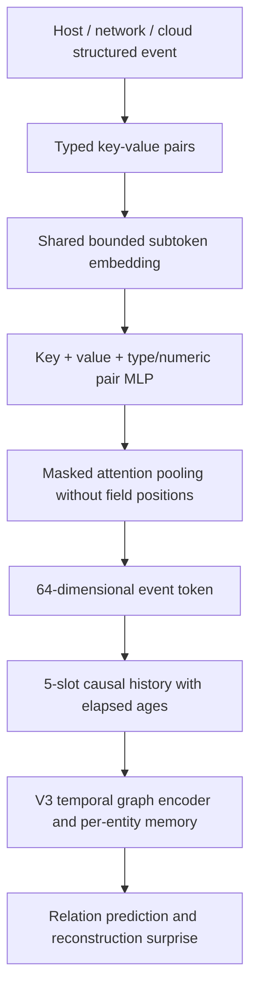

# ORTHRUS / V3 / V4-KV on E3 CADETS

Status: implementation and synthetic acceptance checks available. Full-data acquisition/preparation/training status is stored in Modal volume `tg-detect-orthrus-e3-v1`, `/status.json`. Do not interpret synthetic checks or prior sampled CADETS scores as this study's results.

## Sources and reproduction boundary

- User paper: `research/sec25cycle1-prepub-103-jiang-baoxiang.pdf`.
- Official paper artifact: https://github.com/ubc-provenance/orthrus/tree/usenix-sec-2025
- Pinned commit: `d26613684b83d12e5d1f4bc51283b7de96124776`.
- Pinned ground truth submodule: `012f321f46137650496e639b0ad7e0a66db07a73`.
- Full database acquisition: https://github.com/ubc-provenance/PIDSMaker/blob/velox/settings/ten-minute-install.md
- Structured set representation: Deep Sets, https://arxiv.org/abs/1703.06114; Set Transformer, https://proceedings.mlr.press/v97/lee19d.html.

The exact authors' pipeline is checked out under `research/orthrus_official`, including preprocessing, feature generation, detection, and dependency tracing. The standalone `official.py` loads its unchanged model class definitions with Python AST extraction to avoid unrelated database/plotting imports. The matched runner controls resets and checkpoint selection across arms; this is an explicitly controlled detector comparison, not a claim to duplicate every upstream experiment result.

Recreate the checkout if needed:

```sh
git clone --branch usenix-sec-2025 --recurse-submodules https://github.com/ubc-provenance/orthrus.git research/orthrus_official
git -C research/orthrus_official checkout d26613684b83d12e5d1f4bc51283b7de96124776
git -C research/orthrus_official submodule update --init
```

## Architecture and paper/code discrepancies

The reference is a stateless temporal-neighbor graph transformer, with two TransformerConv layers (8 heads then 1), separate source/destination projections, and an edge-type cross-entropy decoder. It retains the last 20 interactions per entity and scores the current relation before inserting that interaction into the neighbor loader. Endpoint features use Word2Vec128 and three node-type indicators; CADETS has ten supported relations. The pinned CADETS recipe uses 20 epochs, dropout 0.25, learning rate 1e-5, weight decay 1e-5, batch 1024, hidden size128 and output64. The paper discusses other embedding sizes; retain this released recipe rather than silently combining configurations.

The paper describes validation thresholding followed by two-cluster outlier selection. The pinned code instead clusters the top 30 test node scores without first applying the validation threshold. The runner records BOTH maximum-benign-validation threshold results and released top-30 K-means results. These must remain separate. The released Word2Vec trains on all database node attributes (transductive feature fitting). This is recorded and is not described as training-only feature fitting.

The official preprocessing fuses consecutive repeated relations on endpoint pairs and produces approximate 15-minute graphs. All comparison arms consume those same graph files. These are not all raw system events. The upstream batching convention omits within-batch neighbor insertion until after scoring; this differs from event-at-a-time scoring. The controlled runner resets runtime feature caches at each split/epoch. The original runner's cache lifecycle differs; do not call the controlled outputs bitwise original results.

The release also saves and restores its training neighbor loader (`src/data_utils.py`), then runs validation followed by testing without resetting it. This study starts every split with empty graph/history/memory state for all arms and aligns observed neighbor relations with that split. Because the paper's dates are not globally chronological, retained training neighbors could include later-dated activity; this is an inference from the released control flow. The cold split protocol is a disclosed comparison change, and published paper numbers remain separate references.

## Dataset and evaluation

E3 CADETS, April 2018, using the official US/Eastern calendar:

| Partition | Days |
|---|---|
| Train | 3, 4, 5, 7, 8, 9, 10 |
| Benign validation | 2 |
| Test | 6, 11, 12, 13 |

The older local pilot covers only April 2–6 and used 100,000 sampled events with incident-to-node proxy labels. It is rejected by the new coverage gate. Paper training includes dates later than some test dates: this is the published split, not a prospective chronological deployment evaluation. The complete authors' CADETS database dump is 1,465,153,615 bytes, SHA256 `ab3fae64a90d9c8a92a84382195cfd04223a9d8335c1e1690e3cb67c3a441c7a`. Validated HTTP ranges retrieve that dump from the public tar bundle without unrelated datasets. It requires PostgreSQL 17-compatible restore tools.

All three models optimize benign edge-relation reconstruction. No attack labels select epochs or thresholds. The final epoch is selected. Primary metrics are node precision, recall, F1, MCC, PR-AP, ROC-AUC, and confusion counts, evaluated on the exact node universe present in the test graph. Missing ground-truth nodes are also reported. `tracing.py` applies the unchanged released DEPIMPACT component/degree algorithm to each arm's alerts on the original graphs. It records traced nodes, per-seed timing, and attack-group coverage. The released tracing evaluation overwrites repeated nodes' predictions in successive windows; both this behavior and global-union predictions are reported. The upstream tracing orchestration selected best test MCC epoch; this study uses final epoch selection. Attribution output does not by itself establish analyst utility.

## Proposed TGNN_Node_Mem_V4_KV

The name distinguishes this branch from the prior `node_memory_v4.py` decay experiment. It combines one shared event encoder with the V3 graph/history/memory backbone and a ten-relation decoder.



- All event sources use the same learned token table, pair MLP, and attention. Type-specific deterministic preprocessing is not a collection of modality-specific learned encoders.
- The encoder accepts arbitrary keys. Signed-log numeric magnitude, hierarchical IP prefixes, and bounded text/path subtokens avoid an unbounded value vocabulary.
- Absent keys are omitted. Explicit null/nonfinite values get missing indicators. A reserved type token makes completely empty events finite, avoiding all-masked softmax.
- The native V3 interface puts the current query at slot zero, then newest-to-oldest history. Its GRU and CNN reverse history internally. Valid past slots require positive ages; padding is masked. This ordering is asserted in the matched runner acceptance check.
- Dictionary order does not affect representation. Nested keys preserve structure. Field/subtoken limits bound resource use; `tokenize()` exposes field truncation counts. Hash collisions and truncation remain limitations.
- Empty string, null, zero, and false are distinct. Missing entity identifiers are event-local, never one shared global node. Cross-source identities require deliberate correlation rules; equal username text alone is insufficient.
- During reconstruction, the current event type/action is hidden. Only allowlisted endpoint attributes enter the current query. Past observed types may enter history. Raw current messages and arbitrary aliases of the prediction target are excluded.
- All arms share the endpoint attribute contract: type, file/process path, process command, and remote IP. Remote ports are excluded in this CADETS run because the released Word2Vec recipe sets `use_port=False`. V4 changes the representation and fits its encoder during benign training; V3/reference use the same precomputed transductive Word2Vec vectors. Encoder fitting therefore differs and is recorded.
- Missing timestamps cannot establish causal order: graph callers must supply finite observed/ingestion timestamps and record their origin. Missing optional attributes are safe to encode; that does not promise reliable predictions under missing data.
- CADETS tests provenance telemetry only. Multi-source support is an interface property until validated on genuine mixed-source captures and missing-field ablations.
- Set encoding itself is established research. Novelty of the combined architecture has not been established.

For this matched objective, V3/V4 optimize relation cross-entropy only; their earlier supervised replay/budget training schedule is not reused. The native V3 memory transition and admission scorer are retained, including its binary entropy normalization constant. Its auxiliary rate network does not receive a task gradient without the omitted budget loss. This is a known limitation to investigate after the common-objective baseline. Registered parameter counts are 764,202 for the ORTHRUS reference, 350,516 for V3 reconstruction, and 1,406,516 for V4-KV.

`research/universal_events.py` normalizes flat raw events into this envelope and records timestamp origin. For example:

```python
from universal_events import normalize_event
from orthrus_comparison.universal import UniversalEventEncoder
encoder = UniversalEventEncoder()
events = [normalize_event({"type": "login", "user": "admin", "success": True}),
          normalize_event({"type": "cloud_api", "action": "CreateAccessKey"}),
          normalize_event({})]
tokens = encoder(events)  # [3, 64], one shared encoder
```

Seven acceptance checks cover mixed/missing values, permutation invariance, current-target exclusion, causality, gradients/checkpoint reload, all three reconstruction paths, and released tracing/window semantics. Their synthetic scores are excluded from the results ledger.

## Commands

```sh
PYTHONPATH=research /home/mahesh/main_env/bin/python -m pytest -q research/test_orthrus_universal.py
PYTHONPATH=research python -m orthrus_comparison.prepare_official --output artifacts/orthrus_e3_study/prepared
PYTHONPATH=research python -m orthrus_comparison.run --manifest /path/manifest.json --output /path/results --arm TGNN_Node_Mem_V4_KV --epochs 20 --device cuda
python -m modal deploy research/modal_orthrus_study.py
PYTHONPATH=research python research/sync_orthrus_study.py
```

Preparation uses a restored PostgreSQL CADETS database configured by ORTHRUS_DB_HOST/PORT/USER/PASSWORD/NAME. It runs pinned upstream preprocessing and writes a shared manifest. The Modal study uses a dedicated database process and volume. Epoch checkpoints preserve weights, optimizer, RNG and source signature; earlier results are not reused under changed code.

Measured outputs are collected in `artifacts/orthrus_e3_study/RESULTS.md`, `comparison.csv`, and `comparison.json`. The table labels the paper's published values separately and leaves pending measured rows blank. Data hashes, split counts, runtime versions, epoch timing, model parameter counts, GPU memory, and tracing details accompany results. One seed is exploratory; it does not establish statistical superiority.

## Correction to previous results

The previous DEDALE benign TGNN experiment trained a binary classifier with all targets set to benign, retained validation attack labels for calibration, and could include context from excluded attack windows. It was not equivalent to KAIROS/ORTHRUS benign reconstruction training. Its low scores cannot establish that TGNN memory is inherently worse under an equivalent anomaly objective. Its recorded metrics remain historical diagnostics, not evidence of a matched unsupervised comparison.
