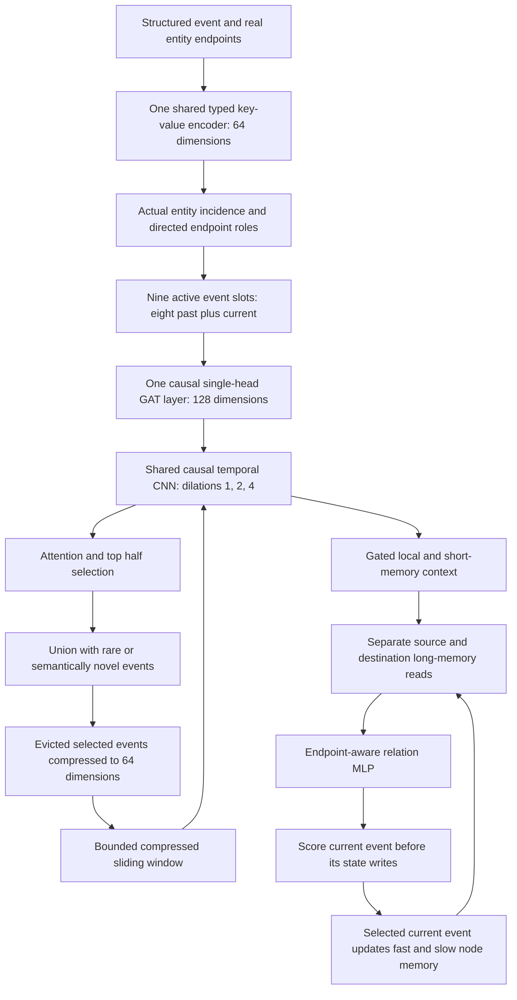

# TGNN Sliding Node Memory

New architecture requested on 8 October 2026. Implementation: `model.py`.
This is a new experiment identity; earlier checkpoints are incompatible.



## Precise behavior

- Default active window: **nine total positions**, including the current query.
  Eight total positions are also configurable. Entity incident queues each keep
  the previous eight events; their union supplies the most recent eight events
  for the query. The stream advances once per observed event.
- Provenance endpoints are real process/file/socket entity IDs. The GAT consumes
  the **causal line graph of sampled event edges**. Two slots connect only when
  their events share an entity; four source/destination equality features retain
  interaction roles. This is a bounded one-hop incident neighborhood, not full
  multi-hop entity-graph propagation.
- Exactly one single-head additive GAT layer outputs 128 dimensions. There is
  **no GRU**, including in the node-memory updater.
- Residual left-padded temporal convolutions use kernel three and dilations
  one/two/four. Their receptive field is 15, covering all nine active slots.
  The SAME CNN parameters process the compressed short-memory window.
- Learned attention selects `ceil(valid_slots / 2)` active events. Selection is
  a union with exceptional current events, so total retention can exceed 50%.
  Selection remains true while an event is active if any query selected it.
- Rarity: first two observations of an observed relation/source-type/destination-
  type signature. A bounded 4,096-entry LRU counter prevents arbitrary identity
  or path values from defining rarity. This is a frequency proxy, not a claim
  that rare means malicious. Counts reset at split boundaries.
- Semantic novelty: cosine distance from the observed current token to its most
  similar available historical token, threshold 0.35. It affects subsequent
  retention/writes, never the current relation prediction.
- Selected events leaving an endpoint queue are compressed into 64-dimensional
  tokens. Each endpoint stores at most eight such tokens. Reads deduplicate
  shared events and supply the latest nine in chronological order to the CNN.
  Tokens include elapsed ages and source/destination/both roles.
- Long memory: 64 fast plus 64 slow dimensions per entity; separate endpoint
  write/read projections. A learned admission gate gives maximum update
  strengths 0.5/0.005. Exact segmented affine scans preserve each event's
  pre-event memory, including repeated entities and self-edges.
- The decoder combines local/short context with separate endpoint memory reads
  using a 384-to-130-to-relation MLP. Attention, compression and write gates have
  task gradients. Hard top-half membership itself is not differentiable.
- Heavy encoding is batched while histories advance event by event. Equal-time
  events follow stable ingestion order. This is not simultaneous-event semantics.
- Active raw events are re-encoded with current weights. Compressed states are
  detached after optimizer steps, as are long-memory states. Future credit is
  limited by that training boundary. Compressed tokens may become stale after
  parameter updates, which is a limitation to measure.
- Required graph metadata: finite ordered timestamps and resolved entity IDs.
  Missing optional key/value fields are safe. Missing identities must be mapped
  to distinct event-local nodes rather than one shared unknown entity.

## Matched CADETS experiment

Profile: `fukatkaamsathi`. App: `tg-detect-sliding-node-mem-e3`. Volume:
`tg-detect-sliding-node-mem-e3-v1`. Both arms start fresh on an L4, seed zero,
20 epochs, batch 1,024, Adam learning rate/weight decay 1e-5. The baseline uses
the pinned ORTHRUS model classes. The complete officially prepared E3 CADETS
data and benign train/validation/test splits are reused with checksum verification.

Both detectors have **exactly 764,202 trainable parameters**. ORTHRUS retains
its released architecture. The sliding model uses 5,303 shared hash buckets
(64 dimensions) and a decoder hidden width of 130. All parameters belong to
modules used by the forward computation; no dummy parameters are added.
`budget.py` asserts equality before either training arm starts and records the
counts in `parameter_budget.json`. This matches detector weights, excluding
fixed Word2Vec preprocessing and entity runtime state. Equal counts do not
guarantee equal compute, memory use or effective capacity. Reducing the token
table from 16,384 to 5,303 buckets increases hash collision risk.

Both arms optimize benign relation reconstruction. Current relation/action
aliases are removed through the CADETS endpoint-attribute allowlist; relation
targets become observed history only after their own prediction. Attack labels
never optimize weights, select epochs, or select thresholds. State is cold at
split boundaries; the latest final epoch is evaluated.

Representations differ: ORTHRUS uses its released Word2Vec node descriptors;
the proposed model learns a shared KV encoder during benign training. This is
an architecture comparison with common allowed attributes, not identical vectors.
The existing KV encoder mean-pools value subtokens and hashes them; collisions,
value-order loss and truncation remain limitations.

Global rehearsal is disabled for both arms in the common-objective comparison.
Earlier supervised TGNN replay objectives are not silently reused. A distinct
replay ablation can be added after the base comparison.

Node anomaly score is maximum incident relation cross-entropy. Report the same
benign-validation maximum threshold, released top-30 KMeans detector, and pinned
dependency tracing (released last-window and global-union evaluations).
Training resumes from periodic checkpoints containing optimizer, chronological
cursor, stream state and RNG; source/protocol mismatches are rejected. Each
model's full evaluation and tracing run only after training finishes.

## Evidence and limits

The design combines established ideas from [temporal graph memory](https://arxiv.org/abs/2006.10637),
[causal convolutional sequence models](https://arxiv.org/abs/1803.01271), and
[ORTHRUS temporal provenance sampling](https://www.usenix.org/system/files/usenixsecurity25-jiang-baoxiang.pdf).
These sources support mechanisms to investigate; they do not establish that
this combination improves intrusion detection or is novel.

Local acceptance covers prediction causality, batch-boundary invariance,
missing fields, graph links, gradients, rare-event retention, bounded state,
snapshot continuation, repeated optimizer steps, and interrupted-run recovery.
Synthetic checks and GPU-prefix throughput measurements are excluded from
research accuracy results. One seed and one dataset cannot establish broad
superiority; ablations are needed to attribute any observed improvement.

## Execution optimization and recovery

The 9 October optimization retains batch 1,024, all learned weights, the
training objective and chronology. Only deterministic token IDs are cached;
learned embeddings are recomputed. Short-window tensors are stacked in one
bulk operation using batch-tensor references and indexed gathers, avoiding
thousands of per-event slice backward nodes. Cyclic garbage collection is
disabled inside the stream loop and restored at epoch/split boundaries;
reference counting continues to release the acyclic history objects.
Differentiable memory scans use touched entity rows, and those
rows are committed in place after backward at the existing detach boundary.
Packed CPU checkpoints transfer compressed tokens in bulk instead of cloning
each CUDA view and save node-memory rows only for observed entities. Unobserved
rows are zero by construction and are restored as zeros. RNG state is restored
from CPU byte tensors. Formats with the earlier full table remain readable.

The exact original source hashes are allowlisted for this one performance
migration. Original checkpoint/source files and the signature transition are
preserved alongside the resumed run. Other protocol/source mismatches still
fail. Completed ORTHRUS results are reused; persistent job IDs prevent the
orchestrator from duplicating live writers after preemption. `performance.json`
records a disposable comparison of both implementations on identical events,
initial weights and optimizer settings; its speed measurements are excluded
from detection accuracy results.

## Commands

```bash
MODAL_PROFILE=fukatkaamsathi ~/main_env/bin/modal deploy research/modal_sliding_node_mem.py
MODAL_PROFILE=fukatkaamsathi PYTHONPATH=research ~/main_env/bin/python -m sliding_node_mem.cloud_copy
MODAL_PROFILE=fukatkaamsathi ~/main_env/bin/modal run --detach research/modal_sliding_node_mem.py --epochs 20
PYTHONPATH=research ~/main_env/bin/python -m pytest -q research/test_sliding_node_mem.py
```
