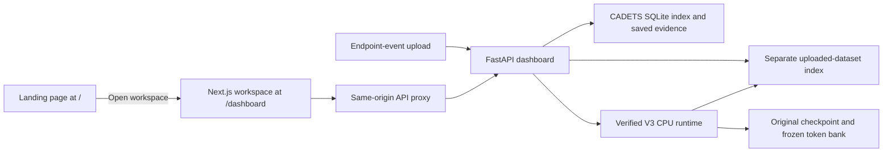

# Architecture

## Application

`frontend/` contains the Next.js App Router application, CSS modules, graph rendering, theme state, and local fonts. The same server serves the landing page at `/` and the existing workspace at `/dashboard`. `frontend/landing/` holds the approved HTML, Three.js/Anime.js source, and the compressed Blender asset. The frontend build generates `public/landing/`; a Next.js rewrite serves its HTML at `/` without loading dashboard styles or runtime. All workspace CTAs use a same-origin `/dashboard` link, and the dashboard brand returns to `/`. API requests pass through the Next.js `/api/` rewrite to the FastAPI process. No browser-side backend origin or duplicated model configuration is needed.

`backend/dashboard/backend.py` creates the FastAPI app. `cadets.py` supplies the CADETS summary, events, evidence, chains, graph, and replay. `graph_datasets.py` handles normalized uploads, background scoring, persistence, and graph search. Normal browsing reads saved, verified evaluation scores; it does not re-run millions of events on each request.

## Frozen V3 model

The trained implementation remains byte-identical under `backend/research/sliding_node_mem_v3/` and its required compatibility packages. The checkpoint source hashes are checked before replay. These dependencies include selected V2/upgrade/shared modules; they are required by V3 and are not additional active deployment models.

1. Chronological source/destination events enter a frozen typed key/value encoder and endpoint identity bank.
2. A causal endpoint-history query reads pre-event state, balancing source and destination history.
3. Event-line graph attention and temporal convolution encode the history window.
4. Selective compression and fast/slow endpoint memory retain bounded temporal context.
5. Relation reconstruction and endpoint-pair plausibility produce event anomaly losses.
6. The original validation calibrator converts losses to evidence, then aggregates incident evidence per entity and time window.

The full tested configuration and diagrams are in [research/architectures](../backend/research/architectures/README.md). The active configuration comes from the original artifact through `/api/cadets/summary`, rather than copied UI constants.

## Investigation

Node evidence reproduces the actual scoring rule. Chain exploration follows observed endpoints and timestamps; the directed construction route requires matching successive endpoints and strictly increasing `(timestamp, event_index)`. Benchmark labels are not used to seed or rank these paths.

The detection graph preserves entity types, observed arrows, prediction classes, bounded context, zoom/fit, focus, search, hops, filters, and export. Prediction colors denote model output; they do not certify an attack.

## Uploaded telemetry

Supported endpoint events are normalized, stably sorted, and encoded with the original trained settings. Inference starts from fresh model state and uses the original batch boundaries, calibration, and threshold. Each upload receives its own SQLite dataset. User-supplied scores and labels are not substituted for inference results.

The corpus, checkpoint, calibrator, frozen source, and original results retain their upstream hashes. The repository reorganization changes their location, while preserving Python package names and the algorithm.
